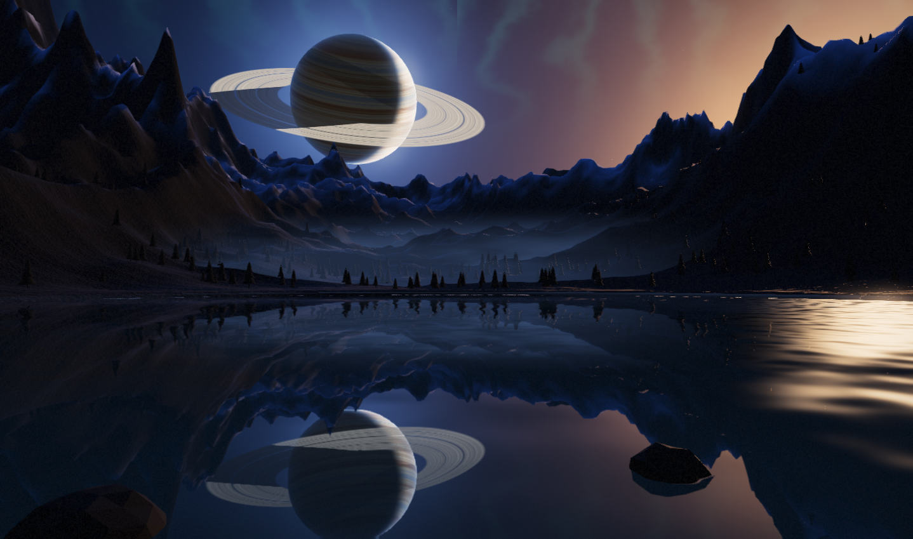

# MIRROR LAKE — 새벽

거울처럼 멈춘 고산 호수 위로 고리가 있는 행성이 내려앉는, 새벽 4시 47분의 풍경.
Three.js 한 파일로 그린 실시간 장면입니다.

**▶ 라이브: <https://lifegameshots.github.io/mirror-lake/>**

## 열기

`index.html`을 더블클릭해 브라우저에서 열면 됩니다. (Chrome / Edge / Firefox 최신 버전)

- Three.js r160을 CDN에서 불러옵니다. **첫 실행에는 인터넷 연결이 필요합니다.**
- WebGL2를 쓰므로 GPU 가속이 켜져 있어야 합니다. (원격 데스크톱 등 소프트웨어 렌더링 환경에서는 느려질 수 있습니다.)

## 장면 구성

| 요소 | 구현 |
| --- | --- |
| 하늘 | 커스텀 GLSL 돔 — 심해 같은 남색 그라디언트, 오른쪽 지평선의 새벽 노을, 별(반짝임), 은하수, 옅은 오로라, 지평선 구름 |
| 행성 | 6,400 유닛 거리의 700 유닛 구체. 심플렉스 노이즈로 만든 띠무늬, 낮/밤 경계, 대기 림, 고리 그림자 |
| 고리 | 링 셰이더 — 방사형 밴드, 카시니 간극, 행성 그림자, 행성 앞뒤를 depth로 정확히 가림 |
| 지형 | 360×360 높이장(약 26만 삼각형). 리지드 노이즈로 만든 봉우리, 설선, 계곡 음영, 절차적 암석 노멀맵 |
| 호수 | 실시간 평면 반사(거울 카메라 + 비스듬한 근접 클리핑) + 프레넬, 물결 왜곡, 태양 글린트, 거리 안개 |
| 숲 | 600그루 안팎의 인스턴스 실루엣 소나무(원뿔 병합 지오메트리) |
| 안개 | 절차적으로 만든 구름 텍스처를 쓴 5장의 미스트 시트 + 수면 위 낮은 안개 |
| 후처리 | 수작업 블룸(소프트 임계값 + 가우시안), ACES 톤매핑, 분할 톤 그레이딩, 비네트, FXAA |

## 움직임

- 카메라가 아주 천천히 앞으로 밀리며(수십 초에 걸쳐 수십 유닛) 미세하게 떠 있습니다.
- 물결, 안개, 별의 반짝임, 행성 띠의 흐름이 각기 다른 주기로 계속 움직입니다.
- 마우스를 움직이면 시선이 부드럽게 따라갑니다.

## 개발용 쿼리 파라미터

| 파라미터 | 기능 |
| --- | --- |
| `?t=12` | 시작 시각(초)을 지정 |
| `?still=1` | 한 프레임만 렌더 (스틸 캡처용) |
| `?capture=1` | 렌더 결과를 `canvas.toDataURL()`로 DOM에 삽입 (헤드리스 검증용) |
| `?debug=1` | 콘솔/렌더 진단을 화면 좌상단에 표시 |
| `?msaa=4` | 씬 렌더타깃에 MSAA 적용 (일부 소프트웨어 렌더러에서 깨질 수 있음) |
| `?rt=byte` | 씬 렌더타깃을 8비트로 (HDR 대신) |

## 메모

- 반사 패스는 화면 해상도의 0.78배로 렌더링합니다.
- 픽셀 비율은 최대 1.5, 총 픽셀은 약 290만 개로 제한해 고해상도 화면에서도 프레임을 지킵니다.
- 모든 난수는 시드 고정되어 있어 새로고침해도 같은 지형이 나옵니다.
